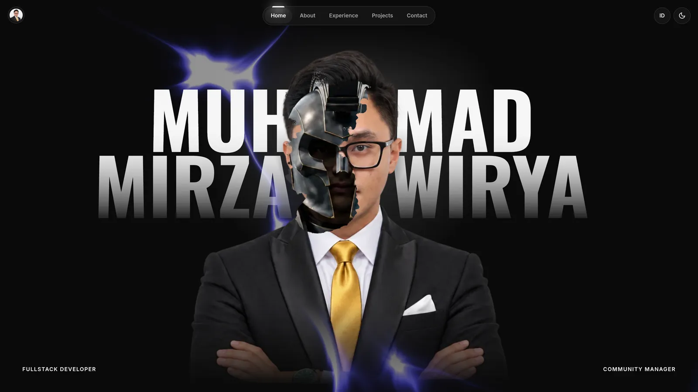

# Muhammad Mirza — Portfolio

[](https://github.com/HorizonMirza/Mirza-Portfolio/actions/workflows/ci.yml)

A bilingual (Indonesian / English) personal portfolio with a Super Admin panel to manage its content.

**Live:** [mmirza.site](https://mmirza.site) · [Bahasa Indonesia](https://mmirza.site/id) · [English](https://mmirza.site/en)



## What's inside

**Public site** — dark by default with a light theme, mobile-first, `ID`/`EN` on every page.

| Section | What you get |
|---|---|
| **Home** | Name behind the photo; hovering (or touching) reveals an armor layer through a WebGL fluid mask, with an automatic peek every 8 seconds. Below: Experience accordion, Projects marquee, a spinning **Technical Skills** globe, and a **GitHub** contribution graph (2D/3D). |
| **About** | Bio, education, and a tilting photo card. |
| **Experience** | Timeline of work and organizations, with filters. |
| **Projects** | Spotlight list with browser-frame previews and detail pages (role, tech stack, gallery, demo and code links). |
| **Contact** | Form with rate limit and honeypot, a swinging ID-card lanyard, and a flip-card "message sent" ticket. |

Also: SEO (sitemap, dynamic Open Graph images, JSON-LD), a read-only public API (`/api/v1`), a privacy page, a custom 404, and UI sounds whose volume the admin controls.

**Super Admin** (`/admin`) — a single owner account (email + password via Better Auth) to manage profile, projects (GitHub import, Cloudinary uploads, draft/published), skills, experience and education, the contact inbox, newsletter subscribers, an audit log, and site settings. Every action is validated with Zod on the server, requires the `SUPER_ADMIN` role, and is written to the audit log.

**Quality** — WCAG 2.2 AA (axe-clean on every page, both themes and languages), `prefers-reduced-motion` respected, strict CSP, and an encrypted daily database backup.

## Tech stack

Next.js 16 (App Router) · React 19 · TypeScript (strict) · Tailwind CSS 4 · next-intl · PostgreSQL (Neon) + Prisma 7 · Better Auth · Zod · Cloudinary · Resend · Vitest + Playwright + axe · pnpm · Vercel · GitHub Actions.

## Run it

Needs Node.js 24, pnpm 10, and a PostgreSQL database. All commands run from `Frontend/`.

```bash
cd Frontend
pnpm install
cp .env.example .env.local   # set DATABASE_URL, BETTER_AUTH_SECRET, ADMIN_EMAIL, ADMIN_PASSWORD
pnpm db:migrate && pnpm db:seed
pnpm dev                     # http://localhost:3000 · admin at /admin
```

Or pull the container image (needs a migrated database):

```bash
docker pull ghcr.io/horizonmirza/mirza-portfolio:latest
```

Before pushing: `pnpm lint && pnpm format:check && pnpm typecheck && pnpm test && pnpm build && pnpm test:e2e`.

## Repository

| Path | Contents |
|---|---|
| `Frontend/` | The Next.js app: public site, `/admin`, route handlers, tests |
| `Database/` | Prisma schema, SQL migrations, and CV seed data |
| `Documentation/` | PRD, design, architecture, [deployment & backup](Documentation/DEPLOYMENT.md), workflow, plan |

## License

© Muhammad Mirza Wirya. All rights reserved. Fonts (Oswald, Inter, JetBrains Mono) are under the SIL Open Font License. Skill logos are trademarks of their owners; sources and licenses are in [`Frontend/scripts/skill-logos/SOURCES.md`](Frontend/scripts/skill-logos/SOURCES.md).
