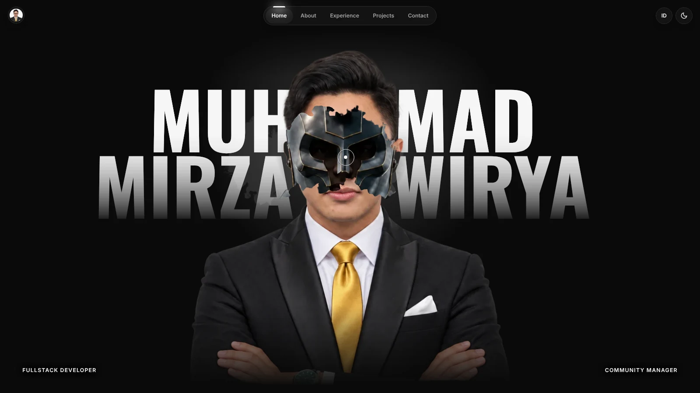

# Muhammad Mirza - Portfolio

Portfolio of Muhammad Mirza with a Super Admin Panel

**Live:** [mmirza.site](https://mmirza.site)

## Modules

Every module comes in Indonesian and English, dark by default with a light theme, and is built mobile-first.

| Module | What's there |
|---|---|
| **Home** | Name behind the photo with a WebGL armor reveal, experience accordion, projects marquee, skills globe, GitHub contribution graph |
| **About** | Bio, education, and a tilting photo card |
| **Experience** | Timeline of work and organizations |
| **Projects** | Spotlight list and detail pages (role, tech stack, gallery, demo and code links) |
| **Contact** | Rate-limited form with honeypot and a "message sent" ticket |
| **Privacy** | What the site collects and why |

## Super Admin Highlights

`/admin` is a single owner account (email and password).

- **Edit in place:** each module is edited directly on a live preview of the public page, in both languages (texts, hero roles, profile, projects, skills, experience, education, footer, navbar)
- **Uploads:** photos and logos through Cloudinary, with an in-browser crop dialog; the CV is a link
- **Inbox and dashboard:** contact messages, a visitor chart (hand-drawn SVG, no chart library), and CV downloads
- **Settings and account:** site options, password, name, and email, plus the login history
- **Safe by default:** server-side Zod validation, `SUPER_ADMIN` role check, and an audit log on every action
- **Housekeeping:** a daily cron job rolls up visits and prunes expired sessions, verification tokens, rate-limit rows, orphaned files, and audit entries older than 365 days; a failing step is reported and never stops the others

## Tech Stack

| Layer | Tools |
|---|---|
| **App** | Next.js 16, React 19, TypeScript (strict), Tailwind CSS 4, next-intl |
| **Motion** | CSS first (scroll-driven, View Transitions), then self-made canvas 2D and WebGL. No animation library; heavy scenes pause when off-screen or while scrolling |
| **Data and auth** | PostgreSQL (Neon), Prisma, Better Auth, Zod |
| **Services** | Cloudinary, Vercel (region `sin1`, daily cron, Speed Insights) |
| **Testing** | Vitest, Playwright, axe (WCAG 2.2 AA) |
| **Delivery** | GitHub Actions CI (lint, format, typecheck, tests, `pnpm audit`, gitleaks, E2E on Chromium, Firefox, and WebKit), auto-deploy to Vercel from `main` |

## Repository

| Path | Contents |
|---|---|
| `Frontend/` | The Next.js app: pages, components, API routes, tests |
| `Backend/` | Server code: Server Actions, database queries, auth, uploads, API logic. Bundled into the Next.js app, one deploy |
| `Database/` | Prisma schema, migrations, seed data |
| `Documentation/` | [PRD](Documentation/PRD.md), [design](Documentation/DESIGN.md), [architecture](Documentation/ARCHITECTURE.md), [workflow](Documentation/WORKFLOW.md), [deployment](Documentation/DEPLOYMENT.md), [TODO](Documentation/TODO.md) |
| `.github/` | CI workflow |

© Muhammad Mirza Wirya. All rights reserved.
